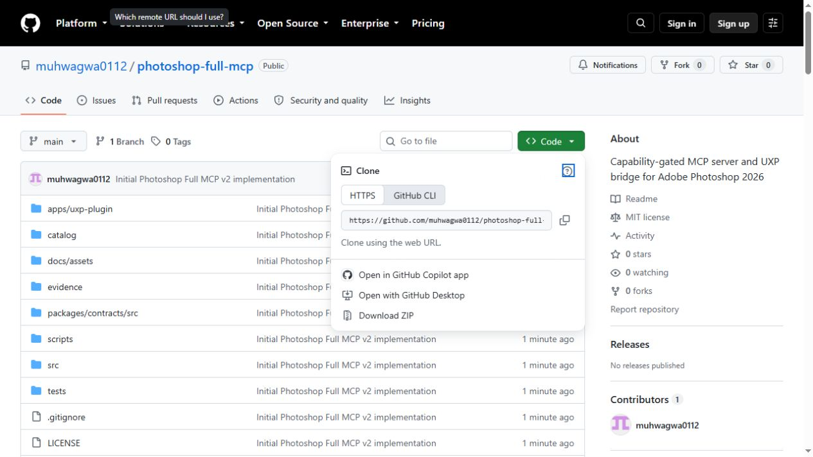

# Windows installation

This guide takes a new user from a GitHub download to a verified `photoshop_host_describe` response. The recommended installation does not depend on a Git checkout and does not require administrator rights.

## 1. Check prerequisites

- Windows 10 or 11
- Adobe Photoshop 24 or later; Photoshop 2026 (27.9) is the reference host
- Node.js 20 or later: `node --version`
- Codex Desktop or Codex CLI: `codex --version`

Close Codex before installing so the next launch discovers the new MCP registration cleanly. Photoshop can remain open, but restart it after installing the plugin.

## 2. Download the release

Open the [latest release](https://github.com/muhwagwa0112/photoshop-full-mcp/releases/latest) and download:

- `photoshop-full-mcp-v2.0.0-windows.zip`

The release also publishes `photoshop-full-mcp-v2.0.0-windows.zip.manifest.json` and its `.sig`. An installed trusted version verifies those files before downloading or extracting an update. The `.sha256` asset is retained only as a convenient corruption check.

Extract the ZIP. The source-code **Download ZIP** menu shown below is a fallback for contributors; ordinary users should prefer the release asset because it already contains the production runtime and CCX package.



## 3. Install the MCP server

Open PowerShell in the extracted `photoshop-full-mcp-2.0.0` folder:

```powershell
powershell -NoProfile -ExecutionPolicy Bypass -File .\Install.ps1
```

The installer:

- requires Node.js 20 or later;
- copies a self-contained runtime to `%LOCALAPPDATA%\PS_MCP\app\versions\2.0.0`;
- installs reusable lifecycle tools under `%LOCALAPPDATA%\PS_MCP\app\tools`;
- registers `photoshop_full_mcp` with Codex using the installed entry point;
- leaves an existing `photoshop_mcp` registration unchanged;
- restores the previous Codex configuration and installed version if registration fails.

The downloaded folder can be deleted after a successful install.

## 4. Install the Photoshop plugin

Recommended route:

1. Double-click `photoshop-full-mcp-v2.0.0.ccx` in the extracted release folder.
2. Accept Adobe's local UXP plugin installation prompt.
3. Restart Photoshop.

Developer fallback:

1. Run Doctor and copy the manifest path from the `uxp-install-path` result.
2. Open **Adobe UXP Developer Tools**.
3. Select **Add Plugin**, choose that `manifest.json`, then click **Load**.

```powershell
powershell -NoProfile -ExecutionPolicy Bypass -File "$env:LOCALAPPDATA\PS_MCP\app\tools\Doctor.ps1"
```

## 5. Pair and verify

1. Open **Plugins > Photoshop Full MCP Bridge** in Photoshop.
2. Restart Codex and start a new task.
3. Call `photoshop_pairing_begin` on `photoshop_full_mcp`.
4. Copy the complete `port-code` value (for example, `38452-AbCdEfGhIjKlMnOpQrStUv`) from the trusted local Windows dialog into the Photoshop panel. The code is a short-lived 128-bit capability, not a six-digit PIN.
5. Call `photoshop_host_describe`.

The installation is successful when the response identifies the Photoshop, UXP, and bridge versions and reports `bridge.connected: true`. The pairing code is intentionally never returned by `photoshop_host_describe`.

If the bridge is disconnected, leave the panel open, run Doctor with `-Live`, and follow [Troubleshooting](TROUBLESHOOTING.md).

## Update

```powershell
powershell -NoProfile -ExecutionPolicy Bypass -File "$env:LOCALAPPDATA\PS_MCP\app\tools\Update.ps1"
```

Update queries the configured GitHub release, verifies the RSA-signed release manifest with the public key installed by the previous trusted version, then downloads the exact archive bound by that signature. It verifies the archive name, size, and SHA-256 before extraction and performs the same transactional install. To update from an already-downloaded archive, keep its `.manifest.json` and `.manifest.json.sig` sidecars beside it:

```powershell
powershell -NoProfile -ExecutionPolicy Bypass -File "$env:LOCALAPPDATA\PS_MCP\app\tools\Update.ps1" -PackagePath .\photoshop-full-mcp-v2.0.0-windows.zip
```

## Uninstall

Remove the Codex registration and installed application while preserving pairing state and exports:

```powershell
powershell -NoProfile -ExecutionPolicy Bypass -File "$env:LOCALAPPDATA\PS_MCP\app\tools\Uninstall.ps1"
```

Remove all Photoshop Full MCP data, including pairing state and exported files:

```powershell
powershell -NoProfile -ExecutionPolicy Bypass -File "$env:LOCALAPPDATA\PS_MCP\app\tools\Uninstall.ps1" -RemoveUserData
```

Uninstalling the UXP plugin is a separate Adobe action. Remove **Photoshop Full MCP Bridge** from the Creative Cloud/UXP plugin manager if it was installed from CCX.
